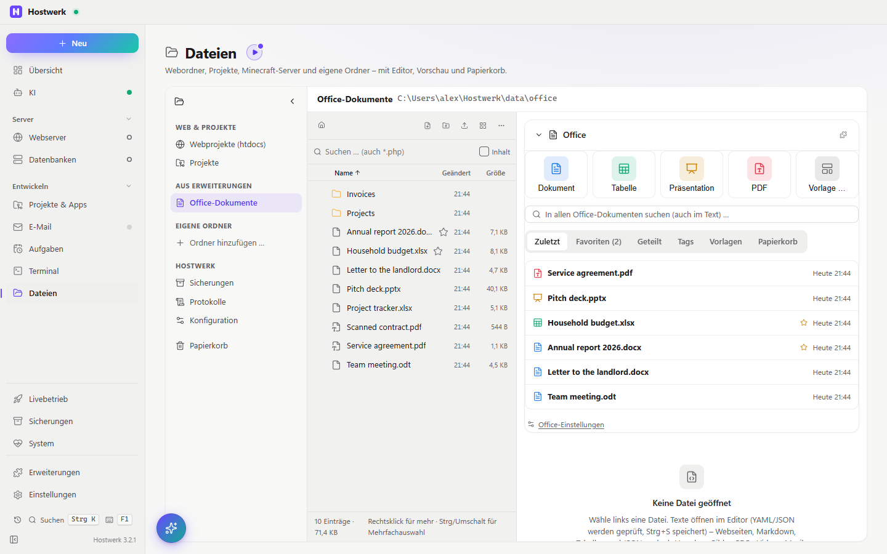

# Office

Dokumente, Tabellen, Präsentationen und PDFs direkt in Hostwerk erstellen, bearbeiten, verwalten und lesen – Microsoft Office (docx, xlsx, pptx und die alten doc/xls/ppt), OpenDocument (odt, ods, odp), Google Docs/Tabellen/Präsentationen, Apple iWork, RTF, Markdown, CSV und vieles mehr. Alles im Hostwerk-Fenster, ohne Browser und ohne dass du etwas von Hand installieren musst.



[English](README.md) · Offizielle [Hostwerk](https://github.com/Passimoritz/hostwerk-public)-Erweiterung (native Erweiterung, Hostwerk mit SDK 3.15 oder neuer)

## Wo du sie findest

**In „Dateien“** – Office hat keinen eigenen Eintrag in der Seitenleiste:

- Der Bereich **„Office-Dokumente“** (unter „Aus Erweiterungen“) ist dein Office-Ordner. Rechts daneben steht der Abschnitt **Office**: Knöpfe für neues Dokument, Tabelle, Präsentation, PDF und Vorlagen, die Volltextsuche über alle Office-Dateien und die Ansichten *Zuletzt*, *Favoriten*, *Geteilt*, *Tags*, *Vorlagen* und *Papierkorb*.
- **Ein Klick** auf ein Dokument, eine Tabelle, eine Präsentation oder ein PDF öffnet es im Office-Editor – in jedem Ordner, nicht nur bei den Office-Dokumenten. Der Editor steht vorne; „Zurück“ führt in denselben Ordner (mit der Datei markiert).
- Im Menü **„Neu“** von Dateien (Knopf und Rechtsklick auf die freie Fläche): Dokument, Tabelle, Präsentation, PDF und „Aus Vorlage oder anderes Format …“ – die Datei entsteht im offenen Ordner und öffnet sich gleich.
- **Rechtsklick** auf eine Office-Datei: im vollen Editor oder in der Desktop-App öffnen, in PDF oder ein anderes Format umwandeln, Freigabe-Link, Versionen, Favorit, Tags/Farbe/Notiz, als Vorlage speichern, Office-Infos. Sterne, Link- und Schloss-Zeichen hinter dem Namen zeigen Favoriten, Freigaben und gerade geöffnete Dateien.
- Hostwerks Menü **„+ Neu“** (oben links) legt Dokumente, Tabellen und Präsentationen bei den Office-Dokumenten an.
- **Einstellungen → Office** – alle Einstellungen, ganz oben die Karte „Hostwerk als Standard-App für Office-Dateien“.

**„Öffnen mit“ und Standard-App (Windows und Linux, Desktop-App):** Beim Installieren meldet sich Hostwerk für die Office-Dateiarten an (docx, xlsx, pptx, odt, ods, odp, pdf, doc, xls, ppt, rtf, csv, md, epub, vsdx, eml, msg, vcf, ics …) – je Windows-Benutzer, ohne Admin-Rechte. Ein Rechtsklick im Explorer → „Öffnen mit“ bietet dann **Hostwerk Office** an; deine bisherigen Programme bleiben Standard. Der große Knopf **„Als Standard-App festlegen“** öffnet die passende Seite der Windows-Einstellungen – dort bestätigst du Hostwerk einmal (Windows erlaubt keiner App, sich selbst zum Standard zu machen). Unter Linux setzt der Knopf nach einer Rückfrage `xdg-mime`. Eine Datei aus dem Explorer öffnet sich direkt im Office-Editor; „Zurück“ zeigt ihren Ordner in Dateien. Abschalten: Einstellungen → Office → Integrationen → „Hostwerk unter „Öffnen mit“ anzeigen“ (oder der Knopf „Aus „Öffnen mit“ entfernen“). Beim Entfernen der Erweiterung meldet Hostwerk alles wieder ab. macOS: Dateiarten kommen dort nur über die App selbst – Office-Dateien öffnest du in Dateien.

## Was sie kann

- **In Dateien:** Zuletzt geöffnet, Favoriten, Schlagwörter mit Farben und Notizen, Freigaben, Vorlagen, Volltextsuche über alle Office-Dateien (auch in PDFs und alten doc/ppt) – Ordner, Hochladen, Ziehen und Ablegen, Kopieren, Verschieben und Papierkorb übernimmt Hostwerks Dateien
- **Dokumente** wie in Word: Formatvorlagen, Schriften, Listen, Tabellen, Bilder, Kopf- und Fußzeilen, Seitenzahlen, Fußnoten, Inhaltsverzeichnis, Kommentare, Änderungen nachverfolgen, Suchen und Ersetzen, Seitenansicht mit Lineal und Navigation – docx, odt, rtf, md, html, txt und doc
- **Tabellen** wie in Excel: Formeln mit Hunderten Funktionen, mehrere Blätter, Zahlenformate, bedingte Formatierung, Datenüberprüfung, Sortieren und Filtern, Diagramme, Fenster fixieren, Zusammenfassung der Auswahl – xlsx, xls, ods, csv und viele weitere
- **Präsentationen** wie in PowerPoint: Folien mit Layouts und Designs, Textfelder, Formen, Bilder, Tabellen, Diagramme, Übergänge und Animationen, Notizen, Bildschirmpräsentation mit Referentenansicht im eigenen Hostwerk-Fenster – pptx, odp und ppt
- **PDFs:** lesen, suchen, markieren, Notizen, Stempel, Unterschrift, Formulare ausfüllen, Seiten umsortieren, drehen, löschen, einfügen, zusammenführen und aufteilen, Texterkennung (OCR), echtes Schwärzen, zwei PDFs vergleichen, Passwortschutz
- **Gemeinsam bearbeiten (1.1):** Dokumente, Tabellen und Präsentationen live mit allen, die in diesem Hostwerk angemeldet sind – mit Cursor, Auswahl und einem, der speichert
- **Live-Daten (1.1):** Live-Felder in Dokumenten und Folien (Datum, Hostwerk-Werte, eine Zelle einer anderen Tabelle), Live-Datentabellen und Tabellen aus Hostwerks Datenbanken als Blätter (Änderungen werden nach deiner Bestätigung zurückgeschrieben), Formulare aus einer Tabelle mit öffentlicher Seite, Regeln mit Benachrichtigung, geplante PDF-Berichte, Kanban-, Kalender- und Galerie-Ansicht eines Blatts
- **Schreiben und Präsentieren (1.1):** „/“-Befehle, LaTeX-Formeln (als echte Office-Formeln gespeichert), Diagramme aus Text (Mermaid), Versionen vergleichen, Präsentation aus einem Dokument, Handy als Fernbedienung per QR-Code, KI-Helfer mit dem Anbieter, den du in Hostwerk eingerichtet hast
- **Sicher teilen (1.1):** passwortgeschützte Word-/Excel-/PowerPoint-/OpenDocument-Dateien öffnen und bleiben beim Speichern verschlüsselt (Passwort oder Hostwerks Passwort-Tresor), vor dem Teilen bereinigen, als Webseite veröffentlichen, Office-Bibliothek in Hostwerks Sicherungen
- **Alles andere lesen:** E-Mails (eml, msg), Kontakte (vcf), Kalender (ics), E-Books (epub), Visio, Apple Pages/Keynote/Numbers, OpenDocument-Zeichnungen, Bilder, JSON, XML und ZIP
- **Google Drive:** mit deinem eigenen Google-OAuth-Client (die Einstellungen zeigen die Schritte) einmal im Hostwerk-Fenster anmelden, dann öffnen sich Google-Dokumente, -Tabellen und -Präsentationen in den eingebauten Editoren und werden zurück zu Google gespeichert
- **Nichts geht verloren:** Teile, die die Editoren nicht bearbeiten (Makros, SmartArt, Pivot-Tabellen, eingebettete Objekte …), bleiben beim Speichern unverändert erhalten
- **Office-Engine:** braucht eine Datei mehr, richtet Hostwerk einmal sein eigenes LibreOffice ein (ohne Installation, ohne Admin-Rechte, mit automatischen Updates); ist Microsoft Office auf dem PC, wird es mitgenutzt
- **Voller Editor:** mit einem Klick ONLYOFFICE über Hostwerks Docker einrichten – für die volle Microsoft-Office-Kompatibilität direkt in der Seite
- **Versionen** bei jedem Speichern (mit Namen, Vorschau und Wiederherstellen), automatisches Speichern, Konflikt-Erkennung, wenn sich eine Datei woanders geändert hat
- **Vorlagen:** Brief (DIN 5008), Rechnung, Lebenslauf, Bericht, Protokoll, Haushaltsbuch, Wochenplan, Projektliste, Pitch-Deck, Fotoalbum und eigene Vorlagen
- **Umwandeln** zwischen allen Formaten und als PDF herunterladen
- **Teilen:** Nur-Lese-Links mit Ablaufdatum und Passwort
- **In Hostwerk eingebaut:** Dateien (Klick öffnet, Menü „Neu“, Rechtsklick, Zeichen, eigener Bereich), Menü „+ Neu“, Schnellsuche, Übersicht (zuletzt geöffnet) und KI-Helfer; „Öffnen mit“ im Betriebssystem
- **Einstellungen** für jeden Bereich: Schrift, Seite und Ränder, Zahlenformate, CSV, Folien-Größe, Präsentation, PDF, Speicherort, Versionen, Papierkorb, Engine und Integrationen

## Installieren

In Hostwerk (ab 3.2.2, Erweiterungs-SDK 3.15): **Erweiterungen → Entdecken** und „Installieren“ klicken. Die farbigen Datei-Symbole und Vorschaubilder in Liste und Raster von Hostwerks Dateien brauchen Hostwerk 3.2.3 (SDK 3.16) – ältere Fassungen zeigen dort Hostwerks eigene Symbole, alles andere funktioniert gleich.

**Bausteine bei Bedarf:** ein paar schwere Teile stecken nicht im Paket und werden beim ersten Gebrauch einmal heruntergeladen (Office fragt vorher und zeigt die Größe; feste Adressen, jede Datei gegen eine festgelegte SHA-256 geprüft; danach funktionieren sie offline): die Texterkennung für PDFs (OCR, Deutsch + Englisch, ≈ 23 MB), Diagramme aus Text (Mermaid, ≈ 14 MB) und die PDF-Schriften für Chinesisch, Japanisch und Koreanisch (≈ 33 MB).

Native Erweiterungen laufen als Teil von Hostwerk (eigener Server- und Oberflächen-Teil). Deshalb installiert Hostwerk sie nur aus dem offiziellen Katalog (mit Prüfsumme) oder im Entwickler-Modus.

## Daten

- `office` im Hostwerk-Datenordner – deine Dateien, in Dateien als „Office-Dokumente“ (Ort in den Einstellungen änderbar)
- `office-data` – Schlagwörter, Notizen, Versionen, Papierkorb, Suchindex, Freigaben, eigene Vorlagen
- `office-engine` – die eigene Office-Engine (nur wenn sie gebraucht wird, etwa 1,5 GB)
- `office-components` – Bausteine bei Bedarf (OCR, Mermaid, asiatische PDF-Schriften – nur die, die du genutzt hast)

Beim Entfernen der Erweiterung bleibt alles erhalten. Nur „Restlos entfernen“ bietet an, auch diese Ordner zu löschen (du siehst vorher jeden mit seiner Größe).

## Entwickeln

```bash
npm ci                               # Bibliotheken für den Build
node --test tests/*.test.js          # Tests
node tools/build.js                  # Oberfläche und Editoren bauen (ui/index.js, ui/assets/*)
node tools/package.js --dir /tmp/pkg # das Release-Paket genau wie die CI es baut (Größe, Inhalt)
node check.js /tmp/pkg --strict      # dieselbe Prüfung wie der Katalog (sdk/check.js auf dem Paket)
```

Oberfläche in `ui/src` (Dateien-Anbindung, Editor-Rahmen und Einstellungen in `ui/src/shell`, Editoren in `ui/src/editors/<art>` – sie werden erst beim Öffnen einer Datei geladen), Server-Teil in `server/`. Texte im Code sind Englisch, Deutsch steht in `locales/de.json`.

## Lizenz

MIT
