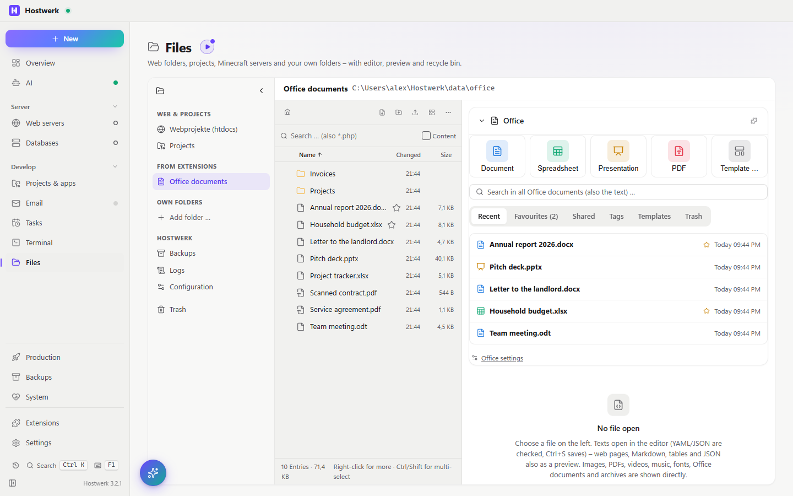

# Office

Create, edit, manage and read documents, spreadsheets, presentations and PDFs right in Hostwerk – Microsoft Office (docx, xlsx, pptx and the legacy doc/xls/ppt), OpenDocument (odt, ods, odp), Google Docs/Sheets/Slides, Apple iWork, RTF, Markdown, CSV and much more. Everything inside the Hostwerk window, without a browser and without installing anything by hand.



[Deutsch](README.de.md) · An official [Hostwerk](https://github.com/Passimoritz/hostwerk-public) extension (native extension, Hostwerk with SDK 3.15 or newer)

## Where you find it

**In Files** – Office has no own entry in the sidebar:

- The root **“Office documents”** (under “From extensions”) is your Office folder. Next to it is the **Office** section: buttons for a new document, spreadsheet, presentation, PDF and templates, full-text search across all Office files and the views *Recent*, *Favourites*, *Shared*, *Tags*, *Templates* and *Trash*.
- **One click** on a document, spreadsheet, presentation or PDF opens it in the Office editor – in every folder, not only in Office documents. The editor is in front; “Back” returns to the same folder (with the file marked).
- Files' **“New”** menu (button and right-click on the empty area): Document, Spreadsheet, Presentation, PDF and “From template or other format …” – the file is made in the open folder and opens right away.
- **Right-click** an office file: open in the full editor or the desktop app, convert to PDF or another format, share link, versions, favourite, tags/colour/note, save as template, Office info. Stars, link and lock marks behind the name show favourites, shares and files open in an editor.
- Hostwerk's **“+ New”** menu (top left) creates documents, spreadsheets and presentations in Office documents.
- **Settings → Office** – every setting, at the top the card “Hostwerk as the default app for office files”.

**“Open with” and default app (Windows and Linux, desktop app):** on install Hostwerk registers itself for the office file types (docx, xlsx, pptx, odt, ods, odp, pdf, doc, xls, ppt, rtf, csv, md, epub, vsdx, eml, msg, vcf, ics …) – per Windows user, no admin rights. Right-click a file in Explorer → “Open with” then offers **Hostwerk Office**; your current apps stay the default. The big button **“Make it the default app”** opens the matching page of Windows' settings – you confirm Hostwerk there once (Windows lets no app make itself the default). On Linux the button sets `xdg-mime` after asking. A file from Explorer opens straight in the Office editor; “Back” shows its folder in Files. Turn it off: Settings → Office → Integrations → “Show Hostwerk under “Open with”” (or the button “Remove from “Open with””). Removing the extension takes Hostwerk out again. macOS: file types come only with the app itself there – open office files in Files.

## What it does

- **In Files:** recent files, favourites, tags with colours and notes, shares, templates, full-text search across all office files (PDFs and legacy doc/ppt too) – folders, upload, drag and drop, copy, move and the trash are Hostwerk's Files
- **Documents** like in Word: styles, fonts, lists, tables, images, headers and footers, page numbers, footnotes, table of contents, comments, track changes, find and replace, print layout with ruler and navigation – docx, odt, rtf, md, html, txt and doc
- **Spreadsheets** like in Excel: formulas with hundreds of functions, several sheets, number formats, conditional formatting, data validation, sort and filter, charts, freeze panes, selection summary – xlsx, xls, ods, csv and many more
- **Presentations** like in PowerPoint: slides with layouts and themes, text boxes, shapes, images, tables, charts, transitions and animations, notes, slide show with presenter view in its own Hostwerk window – pptx, odp and ppt
- **PDFs:** read, search, highlight, notes, stamps, signature, fill in forms, reorder, rotate, delete, insert, merge and split pages, text recognition (OCR), real redaction, compare two PDFs, password protection
- **Edit together (1.1):** documents, spreadsheets and presentations are co-edited live by everyone logged in to this Hostwerk – with cursors, selections and one saver
- **Live data (1.1):** live fields in documents and slides (date, Hostwerk values, a cell of another spreadsheet), live data tables and database tables of Hostwerk's databases as sheets (changes are written back after you confirm), forms from a spreadsheet with a public page, rules with notifications, scheduled PDF reports, Kanban/calendar/gallery views of a sheet
- **Writing and presenting (1.1):** “/” commands, LaTeX formulas (saved as real Office equations), diagrams from text (Mermaid), compare versions, presentation from a document, phone as remote control via QR code, AI helpers with the provider you set up in Hostwerk
- **Safe sharing (1.1):** password-protected Word/Excel/PowerPoint/OpenDocument files open and stay encrypted when saved (password or Hostwerk's password vault), clean before sharing, publish as a web page, Office library in Hostwerk's backups
- **Read everything else:** e-mails (eml, msg), contacts (vcf), calendars (ics), e-books (epub), Visio, Apple Pages/Keynote/Numbers, OpenDocument drawings, images, JSON, XML and ZIP
- **Google Drive:** with your own Google OAuth client (the settings show the steps) sign in once in a Hostwerk window, then Google Docs, Sheets and Slides open in the built-in editors and save back to Google
- **Nothing gets lost:** parts the editors don't edit (macros, SmartArt, pivot tables, embedded objects …) are kept unchanged when saving
- **Office engine:** when a file needs more, Hostwerk sets up its own LibreOffice once (no installation, no admin rights, automatic updates); Microsoft Office on the PC is used as well
- **Full editor:** set up ONLYOFFICE through Hostwerk's Docker with one click – full Microsoft Office compatibility right in the page
- **Versions** on every save (with names, preview and restore), autosave, conflict detection when a file changed elsewhere
- **Templates:** letter (DIN 5008), invoice, CV, report, minutes, household budget, weekly schedule, project tracker, pitch deck, photo album and your own templates
- **Convert** between all formats and download as PDF
- **Share:** read-only links with expiry and password
- **Built into Hostwerk:** Files (click opens, “New” menu, right-click, marks, own root), the “+ New” menu, quick search, the dashboard (recent files) and the AI helper; “Open with” in the operating system
- **Settings** for every area: font, page and margins, number formats, CSV, slide size, slide show, PDF, storage location, versions, trash, engine and integrations

## Install

In Hostwerk (3.2.2 or newer, extension SDK 3.15): **Extensions → Discover** and click “Install”. The coloured file icons and thumbnails in the list and grid of Hostwerk's Files need Hostwerk 3.2.3 (SDK 3.16) – older versions show Hostwerk's own icons there, everything else works the same.

**Components on demand:** a few heavy parts are not in the package and are downloaded once when you first use them (Office asks first and shows the size; fixed addresses, every file checked against a pinned SHA-256; afterwards they work offline): the text recognition engine for PDFs (OCR, German + English, ≈ 23 MB), diagrams from text (Mermaid, ≈ 14 MB) and the PDF fonts for Chinese, Japanese and Korean (≈ 33 MB).

Native extensions run as part of Hostwerk (own server and interface part). That is why Hostwerk only installs them from the official catalogue (with checksum) or in developer mode.

## Data

- `office` in Hostwerk's data folder – your files, shown in Files as “Office documents” (location can be changed in the settings)
- `office-data` – tags, notes, versions, trash, search index, shares, own templates
- `office-engine` – the own office engine (only when it is needed, about 1.5 GB)
- `office-components` – components on demand (OCR, Mermaid, Asian PDF fonts – only those you used)

Removing the extension deletes nothing. Only “Remove completely” offers to delete these folders too (you see each one with its size first).

## Develop

```bash
npm ci                               # libraries for the build
node --test tests/*.test.js          # tests
node tools/build.js                  # build the interface and editors (ui/index.js, ui/assets/*)
node tools/package.js --dir /tmp/pkg # the release package exactly as CI builds it (size, content)
node check.js /tmp/pkg --strict      # same check as the catalogue (sdk/check.js on the package)
```

Interface in `ui/src` (Files integration, editor frame and settings in `ui/src/shell`, editors in `ui/src/editors/<kind>` – loaded only when a file is opened), server part in `server/`. Texts in the code are English, German is in `locales/de.json`.

## License

MIT
